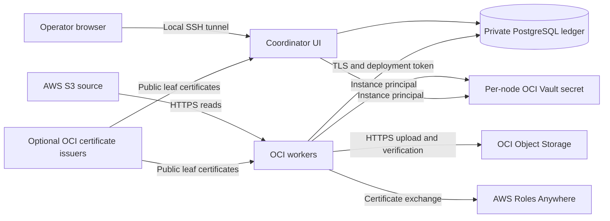

# Architecture and security

The migration runs in the recipient's OCI tenancy. AWS provides source object access; it does not host migration workers. Each worker streams source data to OCI Object Storage and records verification evidence in the private coordinator ledger.

## Components

- **Coordinator:** hosts the private UI and PostgreSQL ledger. It plans bounded jobs, admits runs, tracks worker leases and produces manifest exports. Source inventory and destination checks also require its cloud identities.
- **Workers:** poll for authorized work, read S3, upload to OCI, verify bytes/tags/properties, and update evidence. The UI does not send arbitrary shell commands to them.
- **Ledger:** records immutable profile scope, jobs, batches, leases, attempts, controls and evidence. Completion checks prevent a worker from recording success without required verification.
- **OCI Vault:** holds an encrypted credential bundle per node. Exact-instance rules and per-secret policies restrict access.
- **AWS Roles Anywhere:** exchanges a deployment certificate for temporary AWS role credentials. The generated trust relationship pins the deployment subject and trust anchor. [AWS trust model](https://docs.aws.amazon.com/rolesanywhere/latest/userguide/trust-model.html)
- **Optional OCI issuers:** sign certificate requests while node keys remain local. The application timer handles renewal and activation; issuer setup, CA rollover and old-version retention remain administration tasks.

## Credential boundaries

| Credential | Storage and access |
| --- | --- |
| Administrator cloud login/API material | Administrator's approved credential store; never committed or included in a host release |
| Offline CA keys, manual mode | Passphrase-encrypted on the signing workstation; never sent to nodes |
| Managed issuer keys | Managed through dedicated OCI issuer resources; not exported to nodes |
| Node leaf private keys | Root-only enrollment directory on the node and its encrypted Vault bundle; restored runtime copies on tmpfs |
| Worker deployment token | Private enrollment channel and each authorized node bundle; only its hash in the ledger |
| Operator token | Root-owned coordinator file; browser memory during sign-in; separate from worker token |

Private keys are not exclusively memory-resident. Root access and boot-volume backups can expose retained node key material. A malicious enrolled worker is outside the current isolation model: workers are trusted execution principals, and the deployment token is shared among them. There is no multi-tenant worker sandbox, SSO or per-operator role model.

## Scope and network controls

Installation checks the actual OCI node identity, compartment, region and private IP against the immutable host plan. Workers independently verify the installed deployment profile before claiming jobs. Changing the browser request cannot widen a bucket, prefix or worker limit.

Database access requires TLS, mapped certificate identity and scoped SQL permissions. The database binds to the coordinator private IP; exact worker IPs are configured. NSGs and host firewall rules are separate controls. PostgreSQL is not public.

The UI binds only to coordinator loopback and uses token authentication and same-origin checks. SSH provides transport protection to the browser's local endpoint. Do not publish port 8787 through an internet load balancer without a separately reviewed HTTPS/authentication design.

Internet-mode HTTPS protects data in transit; it does not establish a private interconnect. Private connectivity needs routed networks, endpoints, DNS, security policies and workload-path validation. This portable runtime does not yet admit private-route jobs.

## Data handling

SSE-S3 source objects are read through authorized S3 APIs; AWS encryption keys are not exported. Destination encryption follows the destination bucket/service configuration. Establish any required key ownership, retention and legal-hold design separately.

Manifests and ledger evidence can include tags, metadata, source keys and owner IDs. Treat them as sensitive migration records. Error logging is designed to suppress credential payloads; still review logs before sharing them. Source reads, additional verification reads and requests can incur charges.

## Permissions outside generated policies

The foundation is not a complete IAM deployment. Administrators supply destination Object Storage permissions, Vault key/secret creation rights, and managed issuer key/CRL dependencies. Generated enrollment policies are exact-node/exact-secret statements. Review actual provider enforcement with cross-node negative tests. Application checks complement IAM; they do not replace it.
